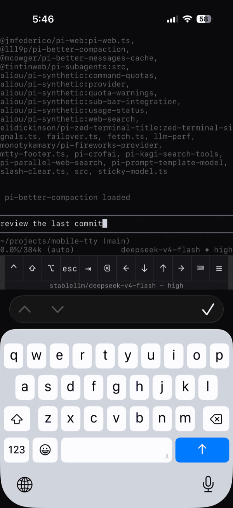
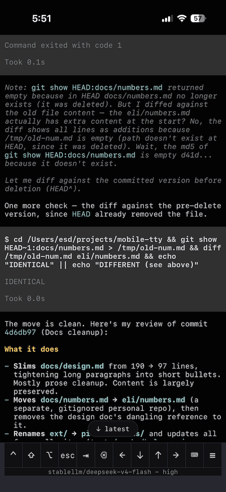

# mobile-tty

Access Pi coding agent from a mobile device (or any browser) without sacrificing features. A Node server keeps the TUI running in the background and streams the whole terminal over a WebSocket to your browser.

 - Works with Chrome/Firefox/Safari on mobile and desktop
 - Shared Pi sessions also still work as regular computer TUI.
 - Can connect multiple devices to the same Pi session and all viewers can type and see changes in real time.
 - Keeps Pi sessions running the background so you can check in on long-running jobs.
 - Can run multiple Pi sessions through a single server and use tabs in the browser interface to jump between them.

<p>
  
    &nbsp;
  
</p>

## Requirements and limitations

- **Node 22+**. Linux also needs Python and a C++ toolchain to compile `node-pty`; macOS gets a prebuilt binary.
- **Tested on iPhone/Safari**; Android seems to work but not fully tested.
- **No alternate-screen apps**, including Claude Code and vim.
- **Scrollback limited to 1000 lines**, including after reconnecting.
- **The narrowest viewer sets the terminal width** for everyone watching that session.

## Quick start

```sh
git clone https://github.com/elidickinson/mobile-tty && cd mobile-tty
npm install
./mobile-tty serve
```

Open http://127.0.0.1:7681 on this machine. The page opens your most recent pi conversation; use `≡` → **New session** for a fresh one (or if you have no saved conversations).

To run the CLI from project folders, add the checkout to `PATH` in another shell:

```sh
export PATH="/absolute/path/to/mobile-tty:$PATH"
```

Add that line to your shell configuration to keep it available in future shells.

### On your phone

For access on the same Wi-Fi, stop the local server with Ctrl-C, then restart it with a password:

```sh
export MTTY_PASSWORD=...  # choose a password
./mobile-tty serve --lan
```

Open `http://<your computer's IP address>:7681` on the phone, then **Add to Home Screen** for about seven extra terminal rows. To use a hostname instead of an IP, add `--hostname NAME` when starting the server. Export the same `MTTY_PASSWORD` in any shell running CLI clients. For remote access, use [Cloudflare Access](#remote-access).

## Everyday usage

```sh
mobile-tty serve          # start the server
mobile-tty sessions       # list running sessions and viewer counts
mobile-tty new            # start a fresh pi in this folder and attach
mobile-tty attach NAME    # join a session; Ctrl-] detaches
mobile-tty end NAME       # stop a session after confirmation
```

`NAME` matches a session's label, folder, path, or ID case-insensitively. Omit it to choose from a list; ambiguous matches also show a picker. A number selects that running-session row from `sessions`. Type `more` to page through pickers. Bare `mobile-tty` lists running sessions, or tells you how to start the server if it is down.

```sh
mobile-tty end --yes NAME           # skip confirmation
mobile-tty serve bash               # run another program
mobile-tty serve pi --model MODEL   # pass arguments to pi
mobile-tty serve --port 1234        # choose the port
```

### Sessions

- Pick a saved conversation from the `≡` menu to start or join its terminal.
- Leaving, detaching, or disconnecting keeps it running; switching sessions does not end the previous one.
- **New session** offers the mobile-tty checkout, folders from saved conversations, and **Other folder…**. Pass `--new-dir ~/code` to change the default; relative paths are resolved from the checkout.
- **End** stops the terminal without deleting its transcript: tap once to confirm, again to stop. Exiting pi does the same.
- Up to six sessions run at once (`--cap N` to change). At capacity, choose one to end before starting another.
- Stopping or restarting the server ends all running sessions.

The menu lists running conversations first, then saved ones by recency, 200 at a time. Rows show pi's session name (otherwise the first prompt or folder) and last activity. Forked conversations, including subagent runs, are not listed separately. Pi's `/new` and `/resume` change the conversation without moving attached viewers.

With pi 1.1.0+, ⏳️ means working and ● means stopped while nobody was watching, including waiting on a dialog. The footer extension includes background subagents in working status.

### Phone controls

- **Key bar:** `⌃ ⇧ ⌥` are sticky modifiers: tap `⌃`, then `c` for Ctrl-C. Backspace and arrows repeat when held. `⌨` toggles the keyboard; `≡` opens the menu.
- **Scrolling:** drag to scroll; tap **↓ N new** to jump to the bottom.
- **Menu:** sessions, Top/Bottom, Paste, grid presets/Fit, zoom, reconnect, Clear view (local only), Reload app, and diagnostics. Grid presets/Fit resize the terminal; zoom only scales the display. ⚡ means disconnected.

Brief disconnects leave the last screen visible and queue keystrokes for replay. If login has expired, use **Menu > Reload app** to log in again.

### Configuration

Flags also read `MTTY_PORT`, `MTTY_BIND`, `MTTY_HOSTNAME`, `MTTY_THEME`, and `MTTY_NEW_DIR`; `MTTY_PASSWORD` sets the login password. Pi history is read from `~/.pi/agent/sessions`, or `PI_CODING_AGENT_SESSION_DIR` if set.

## Remote access

Choose one authentication method, not both.

**Cloudflare Access** is recommended for internet access. You need `cloudflared`, Python 3, a domain on Cloudflare, and a Cloudflare Zero Trust organization. Create an API token with **Account → Access: Apps and Policies → Edit** permission.

```sh
cloudflared tunnel login  # once
export CF_API_TOKEN=... CF_ACCESS_EMAIL=you@example.com
./mobile-tty setup pi.example.com  # tunnel, DNS, config, Access policy
unset MTTY_PASSWORD
./mobile-tty serve --tunnel --hostname pi.example.com
```

If setup cannot read your account ID from the login certificate, export `CF_ACCOUNT_ID` from the Cloudflare dashboard and rerun setup. Alternatively, create a self-hosted Access application for the hostname and an Allow policy for your email manually.

**Do not start the tunnel until Access is configured.** Access authenticates at the edge, so leave `MTTY_PASSWORD` unset. `serve --tunnel` probes for an Access login but does not enforce it. Confirm the public URL requires login. Use the `serve --tunnel --hostname` command above rather than setup's printed startup commands.

**`MTTY_PASSWORD`** provides a login for LAN/tailnet access. CLI clients use the same password. Use plain HTTP only on a trusted network.

**Declare `--hostname` behind any proxy** (or set `MTTY_HOSTNAME`). IP addresses work without it; undeclared names are refused by the WebSocket Origin check. If the page loads but cannot connect, check server stderr.

## Optional pi extensions

**Footer:** adds a current model/thinking bar to bottom of the mobile display. Otherwise, it's sometimes very hard to see on narrow screens.

```sh
pi install ./pi-extensions/mtty-footer.ts
```

**Migration:** adds `/mtty-migrate` convenience function to make it easier to move an idle desktop pi conversation to mobile-tty.

```sh
pi install ./pi-extensions/mtty-migrate.ts
```

Install from the checkout directory. The footer extension is active only under mobile-tty; migration is inactive there.

For migration, start the server and type `/mtty-migrate` in a desktop pi launched with the same `MTTY_PORT` (default 7681) and `MTTY_PASSWORD`. It waits for any running turn, resumes the transcript under mobile-tty, and exits the original pi with an attach command. The phone can then join it. If migration fails, the original pi stays open.

## Development

No build step: client edits need a page reload; server edits need a restart, ending running sessions.

```sh
npm test                # unit tests and snapshot round-trips
npm run typecheck       # vendored TypeScript renderer
npm run test:e2e        # WebKit with fake pi
npm run test:integrity  # verify viewers receive no gaps
npm run test:smoke      # real pi; no prompts or token costs
npm run test:real-pi    # real pi, resized mid-draw
```

See [design and architecture](docs/design.md) for implementation details and rationale.
