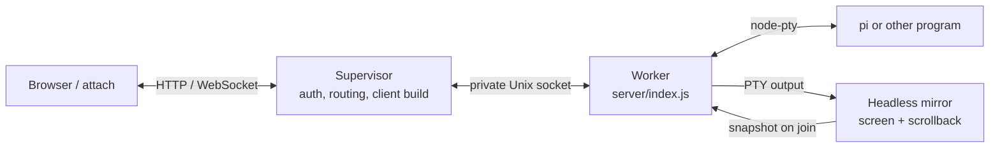

# Design

Architecture and rationale for the current implementation. For setup and user-facing
behavior, see the [README](../README.md).

## Server and sessions

One supervisor routes clients to isolated per-terminal workers:

`server/supervisor.js` handles the HTTP interface and starts workers through
`server/registry.js`. Each worker owns one PTY and serves any number of viewers. It
stays alive when viewers disconnect. The pool is capped at six by default (`--cap`);
restarting the supervisor ends its workers.

A live terminal has a stable process ID, separate from the identity of the pi
conversation it currently displays. Viewers join a process with `/ws?process=<id>`;
opening a saved conversation uses its pi ID and working directory. Pi's `/new` and
`/resume` can change the conversation without changing the process or its viewers.
`server/places.js` combines pi's saved history with running terminals, and
`pi-extensions/mtty-session.ts` reports the conversation currently open in each pi.

Each child forwards PTY bytes to its viewers and to `server/mirror.js`, an
`@xterm/headless` terminal. The mirror supplies joining and reconnecting viewers with
the current screen and scrollback instead of making pi redraw its transcript. The
snapshot is capped at 1000 lines, matching the browser terminal core's limit.

`server/client.js` builds the HTML on request with esbuild, inlining the client,
styles, and VT WASM in one document. Its hash is used for freshness checks and the
ETag. Client edits need a page reload; server edits need a restart, which stops the
sessions.

## Browser terminal and input

`src/app.js` renders through `@wterm/dom` from the vendored `vendor/wterm` package,
using the pinned `@wterm/core` WASM terminal engine. The DOM terminal provides native
scrolling, selection, and find. PTY bytes go directly to the renderer, which owns the
screen and scrollback. The app avoids the alternate screen to keep that history
available to browser scrolling; applications that require it, including vim and
Claude Code, are unsupported. The renderer keeps 1000 lines; reconnecting cannot
restore older history.

Pi's own input box stays visible because its autocomplete depends on it. The cost is
about five or six terminal rows. The vendored renderer's input path mirrors the
hidden keyboard field and sends edits as text changes, which handles iOS dictation,
QuickPath, and held Backspace. Its follow-output behavior checks the scroller's
current position when drawing, avoiding a jump to the bottom during a swipe.

`src/viewport.js` uses `visualViewport` for the visible app area, but keeps the PTY
grid stable while the keyboard opens. The keyboard occludes the grid rather than
forcing pi to reflow mid-input. Orientation changes and explicit grid presets can
resize it. Render zoom only scales the display. Safe-area insets are handled
asymmetrically to preserve rows and keep the key bar clear of the home indicator.

One PTY has one grid for all viewers. The server chooses the narrowest requested
size, so a desktop may show a phone-width terminal. It coalesces resizes and reports
the selected size to viewers. `attach` uses the same protocol and cannot resize the
PTY independently.

## Status and reconnects

The optional `mtty-footer.ts` extension sends model and thinking-level updates to the
server, which replays the latest report to new viewers for the status strip. Pi 1.1.0
and later can report program status through OSC 7501. The server uses that status,
plus the extension's background-subagent count, for the working marker. A blocked
pi is treated as stopped. The unread marker applies when a session stopped after its
last viewer left.

The server retains the screen while no viewers are connected. A dropped connection
leaves the last screen visible, queues input until reconnect, and does not queue
resizes. Snapshots include the bounded scrollback. `attach` is another viewer, with
terminal modes restored on exit and Ctrl-] to detach.

## Access

Choose Cloudflare Access or `$MTTY_PASSWORD`. The password option is intended for a
trusted network. Both use browser cookies: Safari does not send an Authorization
header on a WebSocket handshake, and the page cannot add one. Password tokens live
in memory and are invalidated by a server restart.

The supervisor checks browser `Origin` on the WebSocket handshake to prevent another
site from opening a connection to a local terminal. When the server is behind a
proxy, its hostname must be declared with `--hostname` or `$MTTY_HOSTNAME`; names are
not inferred. Requests without an Origin are allowed for non-browser clients such
as `attach`. The per-terminal Unix sockets are only used by the supervisor's child
processes.

## Constraints and development

The browser terminal core caps scrollback at 1000 lines, and that is also the server
snapshot limit. Its current reflow can lose visible text when columns shrink, and it
answers cursor-position queries but not other terminal queries. These are renderer
limitations; the mirror and client use the same byte stream.

Useful checks:

- `npm test` runs the unit tests, including snapshot round-trips.
- `npm run typecheck` checks the vendored TypeScript renderer.
- `npm run test:e2e` runs the WebKit device tests.
- `npm run test:integrity` checks that viewers are not sent gaps.
- `npm run test:smoke` and `npm run test:real-pi` exercise the real server and pi.
